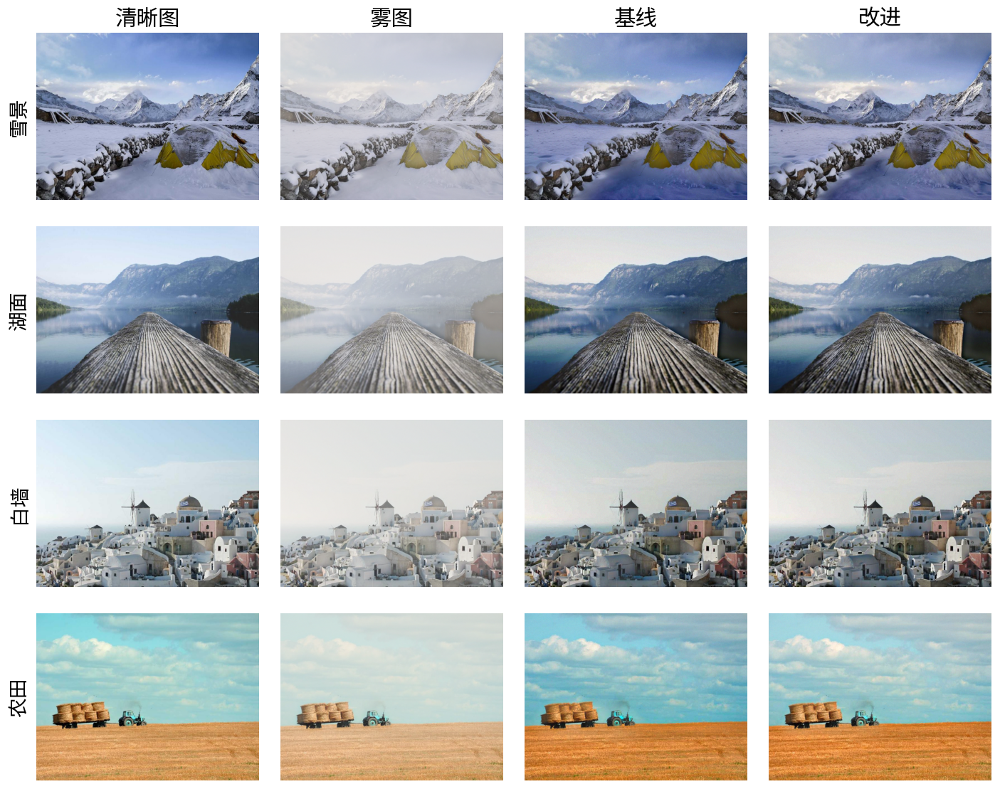
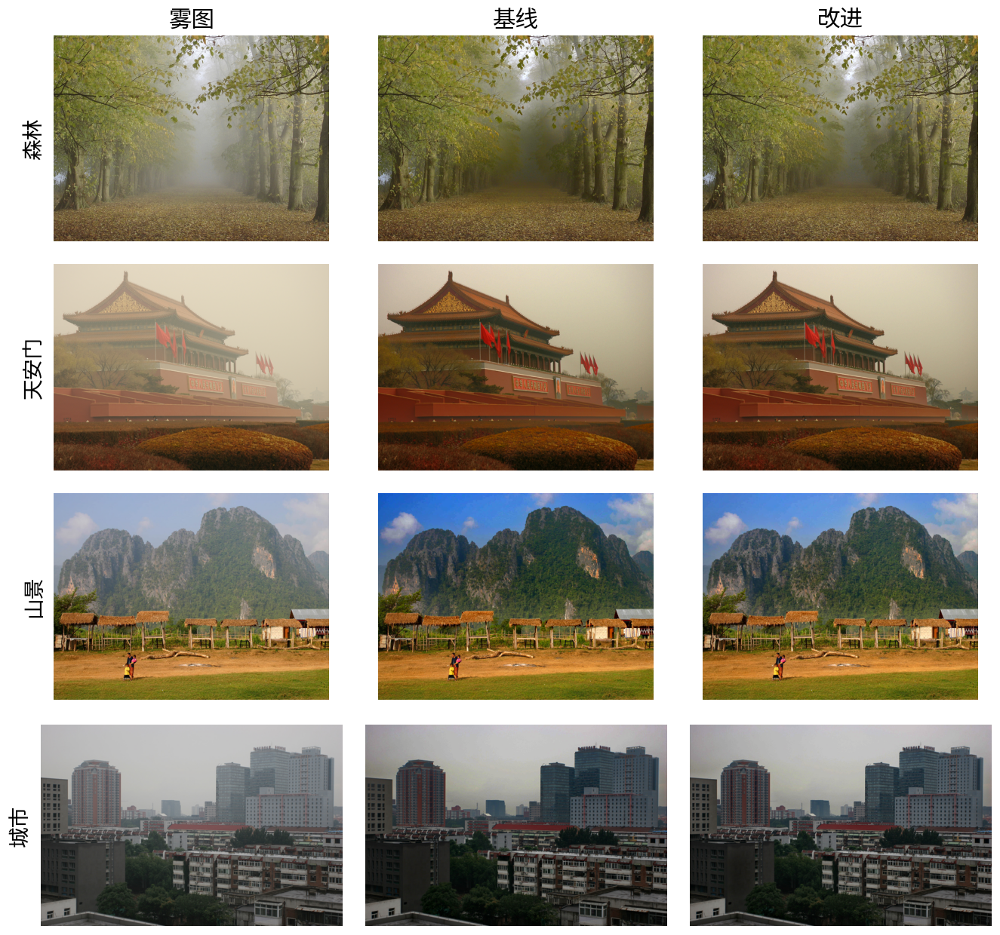
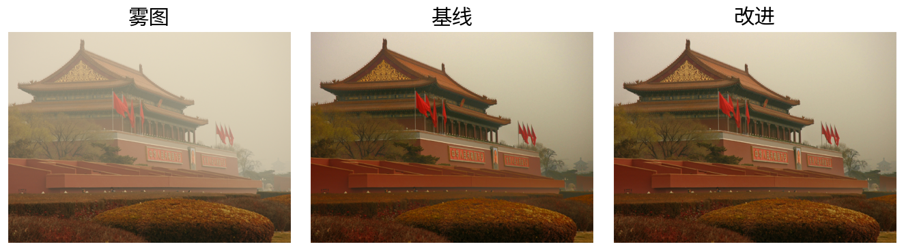

# 单幅图像去雾

基于暗通道先验（Dark Channel Prior, DCP）的单幅图像去雾实现，包含三套预设配置、合成数据生成、配对指标评测与结果出图，全部用 OpenCV / NumPy 写成，不依赖深度学习框架。

仓库自带 12 张清晰图的合成雾图数据（36 对）和 4 张真实雾图，因此 clone 下来即可复现 `results/` 里的指标与图片。注意 CSV 里的 `time_ms` 是单机实测耗时，换机器重跑会有出入，PSNR / SSIM 不受影响。

## 安装

- Python 3.10+
- opencv-python、numpy、scikit-image、matplotlib

```bash
pip install -r requirements.txt
```

## 快速开始

处理一张图：

```bash
python -c "
import cv2
from src import dehaze_image
img = cv2.imread('data/real/mountain.png')
out, info = dehaze_image(img, method='improved')
cv2.imwrite('out.png', out)
print(info['A'], info['omega'], info['sky_ratio'])
"
```

跑一遍完整流程（评测 + 真实图 + 出图 + 测试）：

```bash
bash scripts/run_all.sh
```

## 用法

### 命令行

四个脚本都在仓库根目录执行，参数均有默认值，不加参数即可运行。

| 脚本 | 作用 | 参数 |
|---|---|---|
| `scripts/make_hazy.py` | 由清晰图和构造的深度图合成雾图，写 `metadata.csv` | `--clear`（默认 `data/clear`）、`--out`（默认 `data/synthetic`） |
| `scripts/evaluate.py` | 在调参集/测试集上评测四组方法，写 `metrics.csv`、`summary.csv`、`ablation.csv` | `--data`（默认 `data/synthetic`）、`--out`（默认 `results`） |
| `scripts/run_demo.py` | 处理真实雾图，写对比图和 `real_metrics.csv` | `--input`（默认 `data/real`）、`--out`（默认 `results/samples`）、`--metrics`（默认 `results/real_metrics.csv`） |
| `scripts/make_figures.py` | 生成 `results/figures/` 下的 5 张图 | 无参数，路径相对仓库根目录 |

```bash
python scripts/make_hazy.py      # 已生成过可跳过
python scripts/evaluate.py
python scripts/run_demo.py
python scripts/make_figures.py
```

`evaluate.py` 的评测对象是 `hazy`（雾图本身）、`raw`、`baseline`、`improved` 四组；`run_demo.py` 对每张真实雾图输出 `real_<name>_hazy.jpg`、`real_<name>_baseline.jpg`、`real_<name>_improved.jpg`，并记录对比度、平均梯度、色彩丰富度、信息熵。

### Python API

```python
import cv2
from src import dehaze_image, DehazeConfig

img = cv2.imread("data/real/mountain.png")

# method 取 "raw" / "baseline" / "improved"
out, info = dehaze_image(img, method="improved")

# 也可以直接覆盖任意配置项
out2, info2 = dehaze_image(img, method="baseline", guided_win=31, t0=0.30)

# 或者自己构造一份配置
cfg = DehazeConfig(guided_win=31, use_sky=False, adaptive_omega=True)
out3, info3 = dehaze_image(img, method=cfg)
```

`dehaze_image` 返回 `(uint8 BGR 图, info)`，`info` 中的键：

| 键 | 含义 |
|---|---|
| `A` | 最终使用的大气光（BGR，0–1） |
| `A0` | 仅由暗通道估计的大气光 |
| `omega` | 实际使用的 ω（自适应时与配置值不同） |
| `sky_ratio` | 天空掩膜占全图的比例 |
| `dark` | 暗通道 |
| `t_raw` / `t` | 引导滤波前后的透射率（`t` 已取 `max(t, t0)`） |
| `keep` / `soft` | 天空二值掩膜与高斯软掩膜 |

`src` 另外导出 `guided_filter`、`psnr`、`ssim`、`contrast`、`avg_gradient`、`colorfulness`、`entropy`、`add_haze`、`make_depth`，均为独立函数，可单独调用。

### 预设与参数

`src/dehaze.py` 里的 `PRESETS` 定义了 `raw`、`baseline`、`improved` 三套配置：`raw` 不做引导滤波，`baseline` 是论文原始参数，`improved` 为默认预设（`dehaze_image()` 的 `method` 默认值）。

| 参数 | raw | baseline | improved | 作用 |
|---|---|---|---|---|
| `guided` | `False` | `True` | `True` | 是否对透射率做引导滤波细化 |
| `patch` | 15 | 15 | 15 | 暗通道最小值滤波窗口（15×15） |
| `omega` | 0.95 | 0.95 | 0.95 | 透射率估计中保留的雾量系数，也是自适应 ω 的上限 |
| `adaptive_omega` | `False` | `False` | `True` | 按暗通道均值在 0.82–`omega_cap` 之间调整 ω |
| `t0` | 0.30 | 0.30 | 0.35 | 透射率下限，越小越容易放大噪声 |
| `guided_win` | 80 | 80 | 41 | 引导滤波窗口；`guided=False` 时不起作用 |
| `guided_eps` | 4e-4 | 4e-4 | 1e-3 | 引导滤波正则项，越大越平滑 |
| `use_sky` | `False` | `False` | `True` | 是否启用天空掩膜与条件式大气光 |
| `gamma` | 0.0 | 0.0 | 0.0 | 结果暗部提亮的强度，0 表示关闭 |

`PRESETS` 中没有覆盖的字段沿用 `DehazeConfig` 默认值：`omega_cap=0.95`、`sky_mix=0.5`、`sky_thr=0.01`。`raw` 用于查看不做任何细化时的效果，`baseline` 用于复现论文结果，`improved` 用于日常处理。

## 方法

### 暗通道先验

1. **暗通道**：取三通道最小值，再做 15×15 的最小值滤波，
   `dark(x) = min_{c∈{B,G,R}} ( min_{y∈Ω(x)} I^c(y) )`。
2. **大气光 A**：在暗通道中最亮的 0.1% 像素位置上，取原图颜色的均值。
3. **透射率**：`t(x) = 1 - ω · dark(I/A)`，ω = 0.95，把极小值截到 0.01 防止除零。
4. **细化**：以灰度图为引导图，对 t 做引导滤波（方框均值实现，反射边界）。
5. **恢复**：`J(x) = (I(x) - A) / max(t(x), t0) + A`，结果截断到 [0, 1]。

### 工程上的处理

`improved` 预设除参数调整外，还包含五项针对常见失真的处理：

- **天空掩膜**：用亮度（`mx > 0.55`）、饱和度（`sat < 0.35`）、局部标准差（`std < 0.06`）和纵向位置（`y < 0.55`）筛出候选区域，再做 9×9 闭运算、5×5 开运算和连通域筛选（面积 ≥ 图面积 2%、且位于上部）；找不到合格区域时不使用天空估计。
- **条件式大气光**：分别用暗通道和天空区域估计 A，仅当天空估计不过暗（`A_sky.min() ≥ 0.60`）且暗通道估计明显更亮（均值差 > `sky_thr`）时，按 `sky_mix` 混合两者，用于缓解白色建筑、雪地等亮物体被选作大气光导致的偏色；最终 A 截断到 [0.65, 0.98]。
- **自适应 ω**：按暗通道均值 ρ 在 `clip(0.70 + 0.50·ρ, 0.82, omega_cap)` 内取值，轻雾时少去除一些雾，减少色彩过饱和。
- **引导滤波窗口与正则项**：窗口取 41（baseline 为 80）、`eps` 取 1e-3（baseline 为 4e-4），用于抑制地平线、树叶边缘的过度平滑与光晕。
- **透射率下限**：`t0` 取 0.35（baseline 为 0.30），提高下限以抑制近处景物的噪声放大。

`gamma` 为可选的暗部提亮开关（`auto_gamma`），默认关闭：在调参集上会使 PSNR 下降，见下方消融表。

## 数据

- `data/clear/`：12 张 800×600 清晰户外图，来自 Lorem Picsum（Unsplash License），逐张作者与链接见 `data/SOURCES.md`。
- `data/synthetic/`：36 对雾图/清晰图。深度图由垂直渐变叠加局部纹理构造，按大气散射模型 `I = J·t + A·(1-t)`、`t = exp(-β·depth)` 合成，β 取 0.8 / 1.4 / 2.0，并加入 σ=0.005 的高斯噪声；逐对参数见 `metadata.csv`。
- `data/real/`：4 张真实雾图（森林、天安门、山景、城市），来自 `He-Zhang/image_dehaze` 的 `input/` 目录（MIT），见 `NOTICE.md`。

12 张清晰图按 8 / 4 划为调参集（24 对）与测试集（12 对），划分记录在 `metadata.csv` 的 `split` 列；参数只在调参集上选择，测试集仅用于最终评测。

## 结果

测试集（12 对）平均指标：

| 方法 | PSNR / dB | SSIM |
|---|---|---|
| 雾图（hazy） | 18.06 | 0.904 |
| raw（不做引导滤波） | 18.86 | 0.790 |
| baseline | 19.51 | 0.825 |
| improved | **20.69** | **0.859** |

`improved` 相对 `baseline` 的差值为 +1.18 dB / +0.033 SSIM。按雾浓度分组：轻雾差值最大（+2.22 dB），中雾 +1.66 dB；重雾 PSNR 下降约 0.34 dB 而 SSIM 上升约 0.032。轻雾时两套预设的 PSNR 均低于雾图本身（21.07 dB），此时保留雾感反而更接近清晰图。

测试集逐图平均（三档雾一起平均）：

| 图像 | baseline PSNR / SSIM | improved PSNR / SSIM |
|---|---|---|
| 雪景 | 18.35 / 0.826 | 19.60 / 0.861 |
| 湖面 | 19.30 / 0.824 | 19.86 / 0.849 |
| 白墙 | 20.31 / 0.828 | 21.42 / 0.862 |
| 农田 | 20.07 / 0.823 | 21.88 / 0.863 |

调参集（24 对）上的逐项消融，从 `baseline` 起依次累加：

| 变体 | PSNR / dB | SSIM |
|---|---|---|
| baseline | 22.20 | 0.832 |
| +`use_sky` | 22.26 | 0.832 |
| +`adaptive_omega` | 22.31 | 0.829 |
| +`guided_win=41`、`guided_eps=1e-3` | 22.56 | 0.840 |
| +`t0=0.35` | 22.51 | 0.850 |
| +`gamma=0.5` | 20.94 | 0.824 |



清晰图、雾图、baseline 与 improved 的对比；四行分别为测试集的雪景、湖面、白墙、农田，雾档 β=1.4。



真实雾图、baseline 与 improved 的对比；四行分别为森林、天安门、山景、城市。



失败案例：天安门。大面积白色城墙与暖色天空使天空掩膜和大气光估计失准，两套预设去雾后都偏暗（灰度均值由 144 降到 104 / 108）。

## 目录结构

```
src/
  dehaze.py         去雾主流程、DehazeConfig 与 PRESETS
  sky.py            暗通道、大气光、天空掩膜
  guided_filter.py  引导滤波
  synth.py          深度图构造与大气散射模型合成雾图
  metrics.py        PSNR、SSIM、对比度、平均梯度、色彩丰富度、熵
scripts/
  make_hazy.py      生成合成雾图数据
  evaluate.py       配对指标评测与消融实验
  run_demo.py       处理真实雾图并统计无参考指标
  make_figures.py   生成结果图
  run_all.sh        依次执行上述脚本与测试
data/
  clear/            12 张清晰图
  synthetic/        hazy/、gt/、metadata.csv
  real/             4 张真实雾图
  SOURCES.md        图片出处与许可
results/
  metrics.csv       逐图逐雾档的 PSNR / SSIM
  summary.csv       按 split、方法、雾档汇总
  ablation.csv      调参集消融
  real_metrics.csv  真实雾图的无参考指标
  samples/          真实雾图处理结果
  figures/          README 配图
tests/              指标与去雾流程的单元测试
requirements.txt
```

## 已知限制

- 天空掩膜依赖亮度与色度阈值，大面积白色建筑、亮云、晚霞场景容易误判；此时条件式大气光可能引入偏色，`data/real/tiananmen1.png` 是典型失败案例。
- 合成雾的深度图是人工构造的（垂直渐变 + 纹理），与真实场景的深度分布不同，合成数据上的指标差异不能直接外推到所有真实场景。
- `t0` 与 `ω` 的取值是折中：削雾更彻底会放大噪声并压暗天空，保守取值则残留雾感。
- 仅实现传统方法，未与基于学习的去雾方法对比。

## 参考与致谢

1. K. He, J. Sun, X. Tang. Single Image Haze Removal Using Dark Channel Prior. CVPR 2009.
2. K. He, J. Sun, X. Tang. Guided Image Filtering. ECCV 2010.
3. He-Zhang/image_dehaze：<https://github.com/He-Zhang/image_dehaze>（MIT），真实雾图与基线结构参考该实现。
4. 清晰图来自 Lorem Picsum（Unsplash License），逐张出处见 `data/SOURCES.md`。

作者：祁震淼（东北大学，20245627@stu.neu.edu.cn）

## License

MIT，见 `LICENSE`。第三方图片与代码来源见 `NOTICE.md`、`data/SOURCES.md`。
